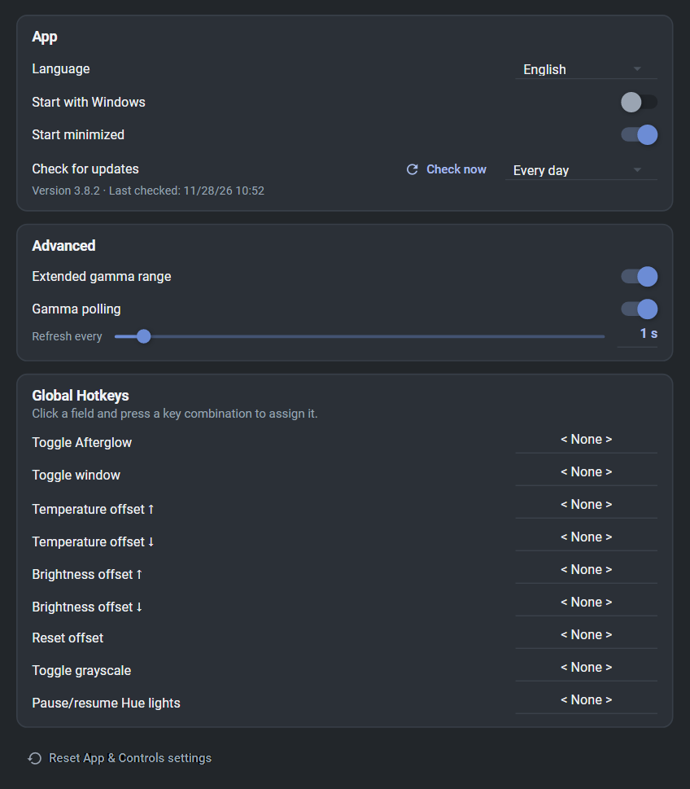

<p align="center">
    
</p>

<h1 align="center">Afterglow</h1>

<p align="center">
    A lightweight Windows tray utility that reduces eye strain by smoothly shifting your screens from cool daylight to warm amber—built as an expanded fork of <a href="https://github.com/Tyrrrz/LightBulb">Tyrrrz's LightBulb</a> with a three-stage cycle, perceptual multi-monitor matching, per-display auto-pause, optional Philips Hue sync, and a sun-driven dynamic wallpaper.
</p>

---


## Features

- **Three-stage cycle with eased transitions.** Moves smoothly through **Day**, **Evening**, and **Night** (with a configurable bedtime) instead of making a single abrupt jump at sunset. Sunrise and sunset come from your location or manual times.
- **Multi-monitor calibration.** Give each display its own temperature offset (up to ±2000 K) and brightness offset, or exclude individual screens. Offsets scale perceptually in **mireds** by default so different panels that match during the day stay matched at night, and settings persist across reconnects and driver updates.
- **Smart auto-pause.** Automatically restores normal colors only on the monitor running a fullscreen app, while the PC is locked, during remote streaming sessions (RDP, Sunshine, and other hosts by port), or when a whitelisted app or window title keyword is in the foreground (globally or per-display).
- **Tray snooze & global hotkeys.** Pause Afterglow, temporarily disable grayscale, or pause Hue lights for **15 minutes**, **1 hour**, **3 hours**, or **until sunrise** directly from the system tray, or bind global hotkeys to toggle features and nudge temperature or brightness.
- **Scheduled or manual grayscale.** Desaturate the screen on demand or automatically at night, in the evening and night, or always—either tinted by the current color temperature or with a neutral white point.
- **Philips Hue sync (optional).** Syncs selected rooms or zones over your local network via the Hue bridge while your PC is on, automatically yielding whenever you adjust lights manually.
- **Dynamic sky wallpaper (optional).** Draws a sun-tracking sky per display (restoring your own wallpaper when turned off) and optionally updates the Windows accent color when the desktop isn't visible. With a location set, it can also reflect local weather and air quality via [Open-Meteo](https://open-meteo.com).
- **Offline-first & self-updating.** Zero telemetry, full UI translations (English, Ukrainian, German, French, Spanish, and Simplified/Traditional Chinese), and built-in one-click updates.

## Download

Download the latest release for Windows 10 or later from the [Releases](https://github.com/Daddysucc/Afterglow/releases) page:

- **Installer (recommended):** `Afterglow-Installer.win-x64.exe` — Installs Afterglow, unlocks the full warm gamma range, sets up Windows startup, and upgrades existing versions in place (including migrating settings from versions older than 3.2).
- **Portable:** `Afterglow.win-x64.exe` — Single standalone executable. Keep it in a permanent folder; running from `Downloads` or a temporary directory stores settings in your user profile and skips Windows startup.

Use the `win-arm64` builds on ARM devices (such as Snapdragon laptops) or `win-x86` on 32-bit Windows.

> [!NOTE]
> Releases aren't code-signed yet, so Windows SmartScreen may warn on first launch—click **More info** → **Run anyway** (PCs with Smart App Control turned on block unsigned executables).

## Screenshots

**System Tray** — Quick-snooze Afterglow, grayscale, or Hue lights without opening the main window.


**Settings** — Everything lives on one tabbed page where any number next to a slider can also be typed in directly.


**Cycle & Colors** — Stage temperatures and brightness, transition durations, grayscale scheduling, and per-display offsets.


**Schedule & Location** — Sunrise/sunset from place search, coordinates, automatic detection, or manual times.


**Pausing** — Automatic pause rules for fullscreen apps, lock screen, remote streaming, and custom app/window title whitelists.


**App & Controls** — Language, startup, update checks, advanced gamma options, and global hotkeys.



**Lights & Wallpaper** — Hue bridge connection, room/light selection, override rules, and dynamic sky wallpaper controls.


## Philips Hue

Afterglow can drive Philips Hue lights (square Bridge or Bridge Pro) directly over your local network while your PC is on, with no extra software or cloud setup.

1. Open **Settings** → **Lights & Wallpaper** and enable **Control Hue lights**.
2. Click **Connect**, then press the button on top of your Hue bridge within 30 seconds (or enter the bridge's IP address first if auto-discovery doesn't find it).
3. Select the rooms or zones to follow the cycle, choose whether they follow color temperature, brightness, or both, and optionally exclude individual bulbs.

**How it behaves:**
- **Your changes take priority.** Changing a light from the Hue app, a wall switch, a scene, or a voice assistant tells Afterglow to leave that light alone (for 1 hour by default, configurable from 5 minutes to 6 hours or until power-cycled).
- **Clean restoration.** Disabling Hue sync, disconnecting, deselecting a room, or closing Afterglow puts lights back how they were—lights that were off stay off, and lights you changed manually keep your settings.
- **Perceptual warmth & dimming.** Because a screen tint looks warmer than a bulb at the same Kelvin value, Afterglow scales bulb warmth and dimming curves (configurable via the **Warmth** and **Dimming** sliders) to match the room.
- **Turning lights on.** Lights that are already on follow the cycle automatically. Use **Turn on lights** in the tray menu (or enable **Turn on lights when Afterglow starts**) to turn selected rooms straight on to the current cycle; Afterglow turns those lights back off when it releases control.
- **Pausing & shutdown.** Pausing lights (via the tray or a hotkey) restores their prior state by default, or keeps Afterglow-activated lights in neutral white—configurable to turn off or apply a custom color/brightness preset. Shutting down or sleeping leaves lights warm by default so the room stays ready for bedtime, and can also be customized.
- **Fullscreen independence.** Fullscreen auto-pause only affects your displays unless **Pause with the screen** is checked. Use **Pause lights** in the tray or a hotkey to pause lights independently.
- **Home Assistant Adaptive Lighting.** To keep lights on a similar schedule while your PC is off, assign [Adaptive Lighting](https://github.com/basnijholt/adaptive-lighting) to separate rooms, or enable its `take_over_control` and `detect_non_ha_changes` options so it yields automatically whenever Afterglow updates bulbs via the Hue bridge.
- **Security & reliability.** Your bridge API key is encrypted for your Windows user account, Afterglow only talks to the paired bridge, and unreachable bulbs at the edge of Zigbee range are retried automatically and flagged in the light list.

## Building from Source

With the [.NET 10 SDK](https://dotnet.microsoft.com/download) installed:

```bash
dotnet publish Afterglow/Afterglow.csproj -c Release -r win-x64 --self-contained -p:PublishSingleFile=true -p:Version=3.5.0
```

This produces a standalone `Afterglow.exe` in `Afterglow/bin/Release/net10.0-windows/win-x64/publish/`.

## Code Signing Policy

Free code signing provided by [SignPath.io](https://about.signpath.io), certificate by [SignPath Foundation](https://signpath.org).

- Committers and reviewers: [Daddysucc](https://github.com/Daddysucc)
- Approvers: [Daddysucc](https://github.com/Daddysucc)

Releases are built from this repository by GitHub Actions, and each one is signed only after it has been approved.
Only Afterglow's own files are signed: the libraries it comes with are signed (or not) by their own authors.
Windows shows the publisher of signed releases as SignPath Foundation.

### Privacy

Afterglow collects no personal data and includes no telemetry. It only makes network requests when specific features are used:

- **GitHub** (`api.github.com` / `github.com`) — Periodic update checks (weekly by default, configurable or disabled under **App & Controls** › **Check for updates**) and downloading updates when approved.
- **Philips Hue** (your local bridge, plus `discovery.meethue.com` if connecting without a manual IP) — Only when **Control Hue lights** is enabled.
- **ip-api.com** — Only when automatic location detection is triggered (receives your IP address).
- **OpenStreetMap Nominatim** (`nominatim.openstreetmap.org`) — Only when searching for a location by name.
- **Open-Meteo** (`api.open-meteo.com`) — Hourly weather and air-quality forecast for your location rounded to ~10 km, only when dynamic wallpaper weather is enabled.

## License

Afterglow is open source under the [MIT License](License.txt).
