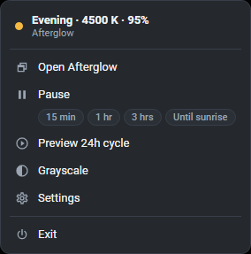

# Afterglow

A fork of [LightBulb](https://github.com/Tyrrrz/LightBulb) by [Oleksii Holub (Tyrrrz)](https://github.com/Tyrrrz), with multi-monitor support, a three-stage day cycle, and a grayscale mode.

<p align="center">
    
</p>

**Afterglow** reduces eye strain from looking at screens late in the day.
As the day goes on, it adjusts the gamma of your displays, shifting their color temperature from cool daylight to warm amber at night, so that your screens match the light around you.
It runs quietly in the system tray and has minimal impact on performance.

## What Afterglow adds

- **Multi-monitor support.** Exclude individual displays, or give each one its own temperature offset (up to ±2000 K) and brightness offset. By default, offsets scale perceptually (in mireds), so that panels matched during the day stay matched at night. The primary display is the reference, and **Identify** shows each display's number on its screen. Saved display settings survive reconnecting the display and graphics driver updates.
- **Three-stage cycle.** Day, Evening, and Night, with a configurable bedtime, instead of a single switch at sunset.
- **Grayscale mode.** Remove color from the screen manually, or on a schedule: at night, in the evening and at night, or always. The color temperature can keep tinting it for a warm monochrome look, or it can use a neutral white point.
- **Smart auto-pause.** Restore normal colors only on the display that runs a fullscreen application, while the screen is locked, during remote streaming (Remote Desktop, or Sunshine and other streaming hosts by port), or while a whitelisted application is in the foreground.
- **Tray menu with snooze chips.** Pause Afterglow, or temporarily disable grayscale, for 15 minutes, 1 hour, 3 hours, or until sunrise, right from the tray.
- **Redesigned interface.** A dashboard with a 24-hour color curve and a plain-language status line, and a full-page settings screen, in English, Ukrainian, German, French, Spanish, and Simplified and Traditional Chinese.

Also included from LightBulb:

- Location-based or manual sunrise and sunset times
- Global hotkeys
- Smooth gamma transitions
- Works without an internet connection (only searching for a location uses it)

## Download

Prebuilt versions are published on the [Releases](https://github.com/trentrichards1/Afterglow/releases) page.
Afterglow requires Windows 10 or later.

### Building from source

With the [.NET 10 SDK](https://dotnet.microsoft.com/download) installed, run:

```
dotnet publish LightBulb/LightBulb.csproj -c Release -r win-x64 --self-contained -p:PublishSingleFile=true -p:Version=3.0.0
```

This produces a standalone `LightBulb.exe` in `LightBulb/bin/Release/net10.0-windows/win-x64/publish/`.

## Coming from LightBulb

For compatibility, Afterglow keeps LightBulb's executable name (`LightBulb.exe`), settings location, and startup entry, so it picks up your existing LightBulb settings.
The installer upgrades an existing LightBulb installation in place.
Only one of the two can run at a time.

## Screenshots




## License

Afterglow is licensed under the [MIT License](License.txt), like LightBulb, and keeps LightBulb's original copyright notice.
