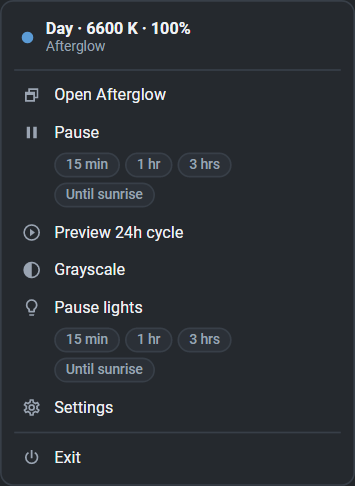

# Afterglow

<p align="center">
    
</p>

**Afterglow** reduces eye strain from looking at screens late in the day.
As the day goes on, it adjusts the gamma of your displays, shifting their color temperature from cool daylight to warm amber at night, so that your screens match the light around you.
It runs quietly in the system tray and has minimal impact on performance.

## Features

- **Three-stage cycle.** Day, Evening, and Night, with a configurable bedtime, instead of a single switch at sunset. Sunrise and sunset come from your location, or from times you set yourself.
- **Gentle transitions.** Every transition eases in and out, so the screen changes smoothly at both ends instead of starting or stopping abruptly.
- **Multi-monitor support.** Exclude individual displays, or give each one its own temperature offset (up to ±2000 K) and brightness offset. By default, offsets scale perceptually (in mireds), so that panels matched during the day stay matched at night. The primary display is the reference, and **Identify** shows each display's number on its screen. Saved display settings survive reconnecting the display and graphics driver updates.
- **Grayscale mode.** Remove color from the screen manually, or on a schedule: at night, in the evening and at night, or always. The color temperature can keep tinting it for a warm monochrome look, or it can use a neutral white point.
- **Smart auto-pause.** Restore normal colors only on the display that runs a fullscreen application, while the screen is locked, during remote streaming (Remote Desktop, or Sunshine and other streaming hosts by port), or while a whitelisted application, or a window whose title contains a whitelisted keyword, is in the foreground (optionally pausing only its display).
- **Tray menu with snooze chips.** Pause Afterglow, or temporarily disable grayscale, for 15 minutes, 1 hour, 3 hours, or until sunrise, right from the tray.
- **Dashboard.** A 24-hour color curve and a plain-language status line, with a full-page settings screen, in English, Ukrainian, German, French, Spanish, and Simplified and Traditional Chinese.
- **Global hotkeys.** Turn Afterglow on or off, show its window, nudge the temperature and brightness, or toggle grayscale from anywhere.
- **Updates in one click.** Afterglow checks for a new version once a week (or as often as you choose), and installs it when you click **Update available**.
- **Works offline.** Only searching for a location, and the optional check for updates, use the internet.

## Download

Download the latest version from the [Releases](https://github.com/Daddysucc/Afterglow/releases) page:

- **Installer (recommended):** `Afterglow-Installer.win-x64.exe`. Installs Afterglow and unlocks the full gamma range, so that the warmest colors work. Afterglow then starts with Windows, and you can delete the downloaded file.
- **Portable:** `Afterglow.win-x64.exe`, a single file that runs without installing. Keep it in a permanent folder: when it runs from Downloads or a temporary folder, Afterglow keeps its settings in your user profile and doesn't start with Windows.

On ARM devices (such as Snapdragon laptops), use the `win-arm64` versions instead, and on 32-bit Windows, the `win-x86` ones.
Afterglow requires Windows 10 or later.

When a new version comes out, Afterglow shows **Update available** on its dashboard. Click it, and Afterglow downloads the new version, checks that it's exactly the released file, installs it, and restarts. An installed copy asks for administrator rights to update; a portable one replaces its own file. If it can't update itself, the button opens the download page instead.

> [!NOTE]
> Afterglow isn't code-signed yet, so Windows may warn about it the first time: select **More info**, then **Run anyway**.
> On PCs with Smart App Control turned on, Windows blocks apps that aren't code-signed.

### Upgrading from an older version

Run the latest installer: it upgrades the version you have in place, keeping your settings and whether Afterglow starts with Windows.
Versions before 3.2 kept their program files and settings in differently named folders; the installer moves your settings over and removes the old version, and a portable copy picks up those settings on its first launch.

Only one copy of Afterglow runs at a time, so if an older version is running, Afterglow asks you to close it first.

### Building from source

With the [.NET 10 SDK](https://dotnet.microsoft.com/download) installed, run:

```
dotnet publish Afterglow/Afterglow.csproj -c Release -r win-x64 --self-contained -p:PublishSingleFile=true -p:Version=3.4.0
```

This produces a standalone `Afterglow.exe` in `Afterglow/bin/Release/net10.0-windows/win-x64/publish/`.

## Screenshots

**Dashboard.** The 24-hour curve shows how the day (6500 K), evening (4200 K), and night (2400 K) stages blend into each other, here with 1.5-hour transitions around sunrise, sunset, and bedtime.


**Tray menu.** Pause or turn off grayscale for a while, right from the system tray.



**Settings.** Everything is on one full-page screen, split into four tabs.


**Cycle & Colors.** The temperature and brightness of each stage, the bedtime that starts the night, how long transitions take, and when grayscale turns on.


**Schedule & Location.** Sunrise and sunset from a searched place, coordinates, or automatic detection, or set by hand.


**Rules & Whitelist.** When to pause automatically, per-display offsets for multi-monitor setups, and the applications and window titles that pause Afterglow.


**App & Controls.** Startup and gamma options, how often to check for updates (with **Check now**, and the version you have), the language, global hotkeys, and resetting all settings.


## Code signing policy

Free code signing provided by [SignPath.io](https://about.signpath.io), certificate by [SignPath Foundation](https://signpath.org).

- Committers and reviewers: [Daddysucc](https://github.com/Daddysucc)
- Approvers: [Daddysucc](https://github.com/Daddysucc)

Releases are built from this repository by GitHub Actions, and each one is signed only after it has been approved.
Only Afterglow's own files are signed: the libraries it comes with are signed (or not) by their own authors.
Windows shows the publisher of signed releases as SignPath Foundation.

### Privacy

Afterglow doesn't collect or send any personal information, and has no telemetry.
It only connects to these services:

- **GitHub** (`api.github.com`), to check for a newer version once a week. In the settings (**App & Controls** › **Check for updates**), you can choose every day, every two weeks, or never, and check right away with **Check now**. When you click **Update available**, the new version is downloaded from `github.com`.
- **ip-api.com**, only when you ask Afterglow to detect your location. It sees your IP address.
- **OpenStreetMap Nominatim** (`nominatim.openstreetmap.org`), only when you search for a place by name. It sees what you searched for.

Like any website, these services see your IP address and Afterglow's version when they're contacted.

## License

Afterglow is open source, under the [MIT License](License.txt).
