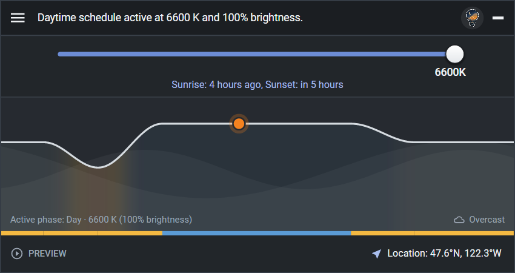
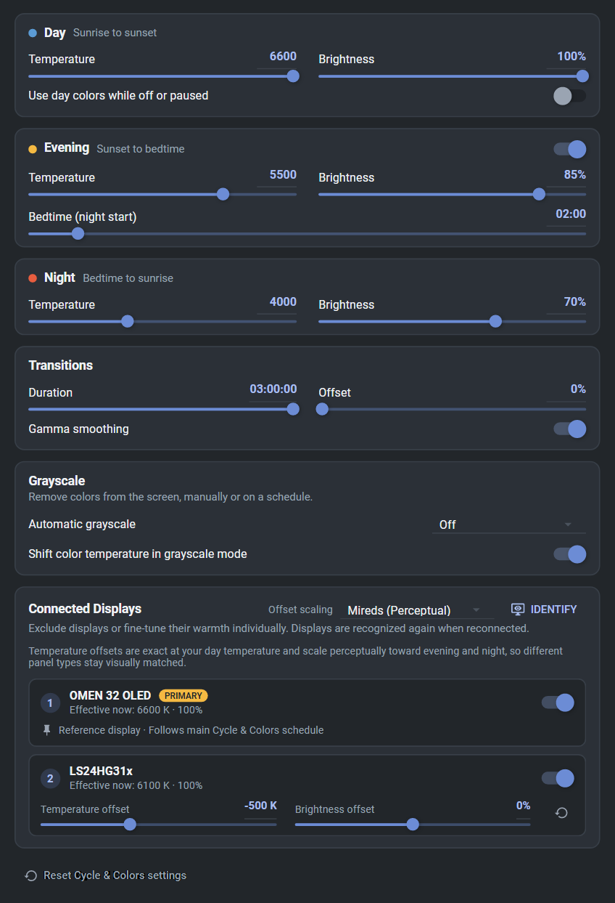
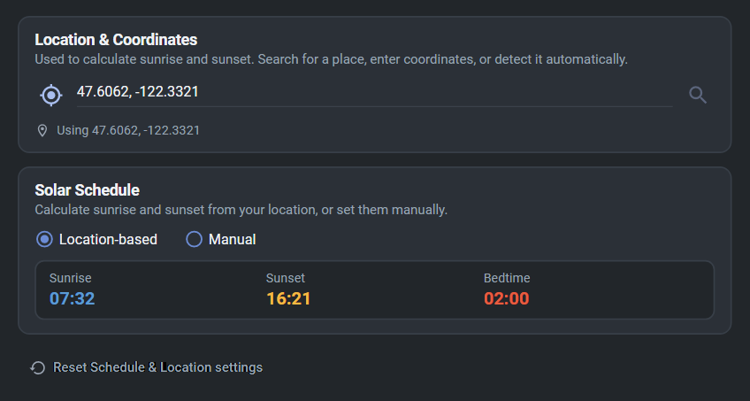
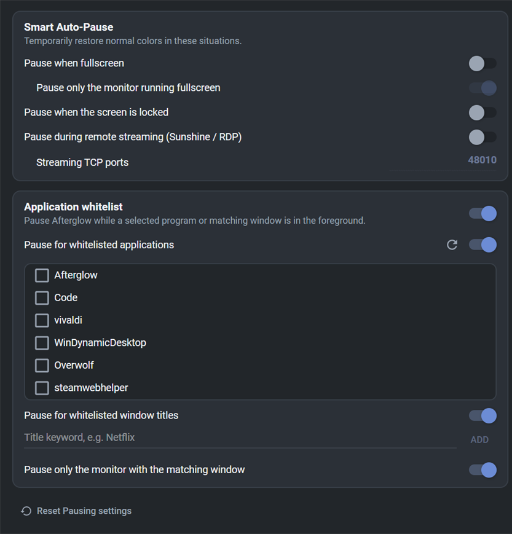
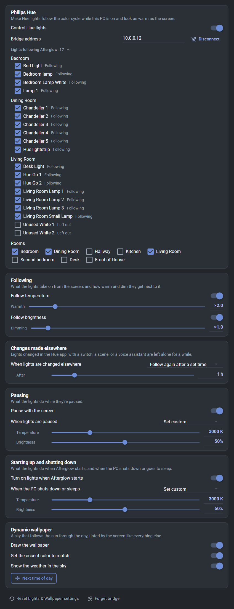

# Afterglow

<p align="center">
    
</p>

**Afterglow** reduces eye strain from looking at screens late in the day.
As the day goes on, it adjusts the gamma of your displays, shifting their color temperature from cool daylight to warm amber at night, so that your screens match the light around you.
It runs quietly in the system tray and has minimal impact on performance.

## Features

- **Three-stage cycle.** Day, Evening, and Night, with a configurable bedtime, instead of a single switch at sunset. Sunrise and sunset come from your location, or from times you set yourself.
- **Gentle transitions.** Every transition eases in and out, so the screen changes smoothly at both ends instead of starting or stopping abruptly.
- **Multi-monitor support.** Exclude individual displays, or give each one its own temperature offset (up to ±2000 K) and brightness offset. By default, offsets scale perceptually (in mireds), so that panels matched during the day stay matched at night. The primary display is the reference, and **Identify** shows each display's number on its screen. Saved display settings survive reconnecting the display and graphics driver updates.
- **Grayscale mode.** Remove color from the screen manually, or on a schedule: at night, in the evening and at night, or always. The color temperature can keep tinting it for a warm monochrome look, or it can use a neutral white point.
- **Smart auto-pause.** Restore normal colors only on the display that runs a fullscreen application, while the screen is locked, during remote streaming (Remote Desktop, or Sunshine and other streaming hosts by port), or while a whitelisted application, or a window whose title contains a whitelisted keyword, is in the foreground (optionally pausing only its display).
- **Tray menu with snooze chips.** Pause Afterglow, temporarily disable grayscale, or pause your Hue lights, for 15 minutes, 1 hour, 3 hours, or until sunrise, right from the tray.
- **Dashboard.** A 24-hour color curve and a plain-language status line, with a full-page settings screen, in English, Ukrainian, German, French, Spanish, and Simplified and Traditional Chinese.
- **Global hotkeys.** Turn Afterglow on or off, show its window, nudge the temperature and brightness, toggle grayscale, or pause your Hue lights from anywhere.
- **Updates in one click.** Afterglow checks for a new version once a week (or as often as you choose), shows what's new since your version, and installs it when you click **Update**.
- **Philips Hue.** Lights in the rooms you choose follow the color cycle while your PC is on, through the Hue bridge, without anything else to set up (see [Philips Hue](#philips-hue)).
- **Works offline.** Only searching for a location, and the optional check for updates, use the internet (and, if you turn it on, Philips Hue, which stays on your own network).

## Download

Download the latest version from the [Releases](https://github.com/Daddysucc/Afterglow/releases) page:

- **Installer (recommended):** `Afterglow-Installer.win-x64.exe`. Installs Afterglow and unlocks the full gamma range, so that the warmest colors work. Afterglow then starts with Windows, and you can delete the downloaded file.
- **Portable:** `Afterglow.win-x64.exe`, a single file that runs without installing. Keep it in a permanent folder: when it runs from Downloads or a temporary folder, Afterglow keeps its settings in your user profile and doesn't start with Windows.

On ARM devices (such as Snapdragon laptops), use the `win-arm64` versions instead, and on 32-bit Windows, the `win-x86` ones.
Afterglow requires Windows 10 or later.

When a new version comes out, Afterglow shows what's new since your version, with **Update** and **Later** buttons (if you're in a fullscreen game, it shows a notification instead, and waits until you next open it). **Later** doesn't bring that version up again, but the dashboard keeps showing **Update available**. When you choose to update, Afterglow downloads the new version, checks that it's exactly the released file, installs it, and restarts. An installed copy asks for administrator rights to update; a portable one replaces its own file. If it can't update itself, the button opens the download page instead.

> [!NOTE]
> Afterglow isn't code-signed yet, so Windows may warn about it the first time: select **More info**, then **Run anyway**.
> On PCs with Smart App Control turned on, Windows blocks apps that aren't code-signed.

### Upgrading from an older version

Run the latest installer: it upgrades the version you have in place, keeping your settings and whether Afterglow starts with Windows.
Versions before 3.2 kept their program files and settings in differently named folders; the installer moves your settings over and removes the old version, and a portable copy picks up those settings on its first launch.

Only one copy of Afterglow runs at a time, so if an older version is running, Afterglow asks you to close it first.

### Building from source

With the [.NET 10 SDK](https://dotnet.microsoft.com/download) installed, run:

```
dotnet publish Afterglow/Afterglow.csproj -c Release -r win-x64 --self-contained -p:PublishSingleFile=true -p:Version=3.5.0
```

This produces a standalone `Afterglow.exe` in `Afterglow/bin/Release/net10.0-windows/win-x64/publish/`.

## Philips Hue

Afterglow can make Philips Hue lights follow the color cycle directly, through the Hue bridge (the original square bridge or the Bridge Pro), while your PC is on. Nothing else needs setting up.

1. In Afterglow, open the settings, then the **Lights & Wallpaper** tab, and turn on **Control Hue lights**.
2. Click **Connect**, then press the button on top of the bridge within 30 seconds. Afterglow finds the bridge on its own; if it can't, enter the bridge's IP address (shown in the Hue app, under **Settings** › **Bridges**) first.
3. Choose the rooms (or zones) whose lights follow Afterglow, and whether they follow its color temperature, its brightness, or both. Click the line that says how many lights are following to see each light, and to leave out any you don't want following.

How the lights behave:

- **Lights are only turned on when you ask.** Lights that are on follow the cycle, and a light that's turned on takes on the cycle within a few seconds. **Turn on lights** in the tray menu turns on the lights in your chosen rooms, straight to the cycle; Afterglow turns them off again when it lets go of them. To have them all turned on whenever Afterglow starts (and when the PC wakes up), turn on **Turn on lights when Afterglow starts**.
- **Your changes win.** When you change a light yourself (in the Hue app, with a switch, a scene, or a voice assistant), Afterglow leaves it alone, by default for an hour after its last change. Under **When lights are changed elsewhere**, you can choose another time (from 5 minutes to 6 hours), or leave such lights alone until they're turned off and on again. **Follow again** next to a light in the list of lights follows it again right away.
- **Lights go back to how they were** when Afterglow lets go of them: when you turn this off, disconnect, deselect their room or leave them out, or close Afterglow. Lights that were turned off stay off, lights you changed yourself keep your setting, and lights that Afterglow turned on are turned off again.
- **Pausing** (from the tray or with a hotkey, while Afterglow is paused, or along with the screen) also puts lights back by default, though lights that Afterglow turned on stay on, in a neutral white. Under **When lights are paused**, you can choose to leave them as they are, turn them off (they come back on afterwards), or set them to a color temperature and brightness of your own (hold the mouse button down on a slider to see it on the lights). Either way, they follow the cycle again once the pause is over.
- **When the PC shuts down, restarts, signs out, or goes to sleep,** lights are left as they are by default, so that the room stays as warm as it was at bedtime. You can choose to have them put back as they were, turned off, or set to a color temperature and brightness of your own, instead (**When the PC shuts down or sleeps**). Lights that Afterglow turned on are turned off, unless you choose your own look. After sleep, lights carry on following.
- **Lights follow what the screen shows**, including the cycle preview and any adjustments from the slider or hotkeys. A tint on a screen looks much warmer than a light of the same color temperature, so lights are set warmer than the screen (by how much is up to you, with the **Warmth** slider): the screen's untinted white is a neutral 4000 K, and warmer tints are warmer still. Lights that show colors turn amber and orange once they run out of warm whites, and white-only lights stop at their warmest white. **Dimming** sets how strongly lights dim as the screen does (full brightness always stays full).
- **Pausing for fullscreen apps and the like only concerns the screens**, unless you turn on **Pause with the screen**. To give the lights a break without touching the screens, use **Pause lights** in the tray menu, or set a hotkey for it under **Global hotkeys**.

Afterglow checks the lights every few seconds while it's controlling them, and only sends a change when it's big enough to see (and exactly what you choose, when you move a slider). Lights that don't take a change, such as ones at the edge of the bridge's reach, are sent it again until they do, and the list of lights shows which ones aren't responding. The key the bridge gives Afterglow is stored encrypted for your Windows account, and Afterglow only talks to the bridge it first connected to.
While **Control Hue lights** is turned off, none of this runs.

To keep lights following a similar curve while your PC is off, [Adaptive Lighting](https://github.com/basnijholt/adaptive-lighting) for Home Assistant does that well. Give it rooms that Afterglow doesn't control, or turn on its `take_over_control` and `detect_non_ha_changes` options (Afterglow changes lights through the bridge rather than through Home Assistant), so that it stops adjusting a light once Afterglow does; otherwise the two keep overriding each other.

## Screenshots

**Dashboard.** The 24-hour curve shows how the day (6500 K), evening (4200 K), and night (2400 K) stages blend into each other, here with 3-hour transitions around sunrise, sunset, and bedtime, mid-way through sunrise.



**Tray menu.** Pause or turn off grayscale for a while, right from the system tray.


**Settings.** Everything is on one full-page screen, split into five tabs. The header also has a link to this page, and the same on/off and hide-to-tray buttons as the dashboard. Every number next to a slider can also be typed in.


**Cycle & Colors.** The temperature and brightness of each stage (and whether to keep the day's colors while Afterglow is off or paused), the bedtime that starts the night, how long transitions take, when grayscale turns on, and per-display offsets for multi-monitor setups.



**Schedule & Location.** Sunrise and sunset from a searched place, coordinates, or automatic detection, or set by hand.



**Pausing.** When to pause automatically (fullscreen, a locked screen, remote streaming), and the applications and window titles that pause Afterglow.



**App & Controls.** The language, startup, how often to check for updates (with **Check now**, and the version you have), advanced gamma options, and global hotkeys.


**Lights & Wallpaper.** Connecting to a Philips Hue bridge, and how your lights follow the cycle, react to changes made elsewhere, pause, and behave at startup and shutdown (once connected, it also lists your rooms and their lights), and the dynamic wallpaper and accent color for a monitor's backlight. Each tab can reset its own settings with the button at its bottom.



## Code signing policy

Free code signing provided by [SignPath.io](https://about.signpath.io), certificate by [SignPath Foundation](https://signpath.org).

- Committers and reviewers: [Daddysucc](https://github.com/Daddysucc)
- Approvers: [Daddysucc](https://github.com/Daddysucc)

Releases are built from this repository by GitHub Actions, and each one is signed only after it has been approved.
Only Afterglow's own files are signed: the libraries it comes with are signed (or not) by their own authors.
Windows shows the publisher of signed releases as SignPath Foundation.

### Privacy

Afterglow doesn't collect or send any personal information, and has no telemetry.
It only connects to these services:

- **GitHub** (`api.github.com`), to check for a newer version once a week. In the settings (**App & Controls** › **Check for updates**), you can choose every day, every two weeks, or never, and check right away with **Check now**. When you click **Update available**, the new version is downloaded from `github.com`.
- **Your Philips Hue bridge**, only if you turn on Hue control. It receives the colors to set your lights to. To find the bridge, Afterglow asks the Philips Hue discovery service (`discovery.meethue.com`) when you click **Connect** without an address (and if the bridge later moves to a new address), which sees your IP address.
- **ip-api.com**, only when you ask Afterglow to detect your location. It sees your IP address.
- **OpenStreetMap Nominatim** (`nominatim.openstreetmap.org`), only when you search for a place by name. It sees what you searched for.

Like any website, these services see your IP address and Afterglow's version when they're contacted.

## License

Afterglow is open source, under the [MIT License](License.txt).
