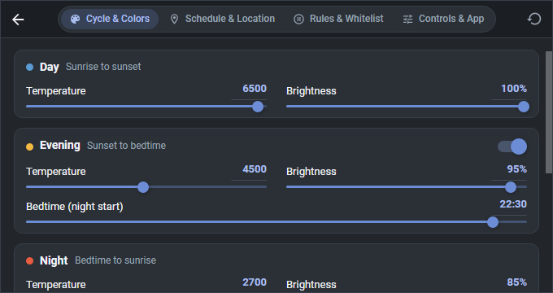

# Afterglow

> **LightBulb was made in Ukraine.** Afterglow is built on [LightBulb](https://github.com/Tyrrrz/LightBulb) by [Tyrrrz (Oleksii Holub)](https://github.com/Tyrrrz). Its author asks users to condemn Russia's war against Ukraine and support its territorial integrity.
>
> [Read his statement](https://tyrrrz.me/ukraine) · [Donate to Tyrrrz](https://tyrrrz.me/donate)

A fork of [LightBulb](https://github.com/Tyrrrz/LightBulb) by [Oleksii Holub (Tyrrrz)](https://github.com/Tyrrrz), with multi-monitor support, a three-stage day cycle, and a grayscale mode.

<p align="center">
    
</p>

**Afterglow** reduces eye strain from looking at screens late in the day.
As the day goes on, it adjusts the gamma of your displays, shifting their color temperature from cool daylight to warm amber at night, so that your screens match the light around you.
It runs quietly in the system tray and has minimal impact on performance.

## What Afterglow adds

- **Multi-monitor support.** Exclude individual displays, or give each one its own temperature offset (up to ±2000 K) and brightness offset. By default, offsets scale perceptually (in mireds), so that panels matched during the day stay matched at night. The primary display is the reference, and **Identify** shows each display's number on its screen. Saved display settings survive reconnecting the display and graphics driver updates.
- **Three-stage cycle.** Day, Evening, and Night, with a configurable bedtime, instead of a single switch at sunset.
- **Grayscale mode.** Remove color from the screen manually, or on a schedule: at night, in the evening and at night, or always. The color temperature can keep tinting it for a warm monochrome look, or it can use a neutral white point.
- **Smart auto-pause.** Restore normal colors only on the display that runs a fullscreen application, while the screen is locked, during remote streaming (Remote Desktop, or Sunshine and other streaming hosts by port), or while a whitelisted application, or a window whose title contains a whitelisted keyword, is in the foreground (optionally pausing only its display).
- **Tray menu with snooze chips.** Pause Afterglow, or temporarily disable grayscale, for 15 minutes, 1 hour, 3 hours, or until sunrise, right from the tray.
- **Redesigned interface.** A dashboard with a 24-hour color curve and a plain-language status line, and a full-page settings screen, in English, Ukrainian, German, French, Spanish, and Simplified and Traditional Chinese.

Also included from LightBulb:

- Location-based or manual sunrise and sunset times
- Global hotkeys
- Smooth gamma transitions
- Works without an internet connection (only searching for a location, and the optional check for updates, use it)

## Download

Download the latest version from the [Releases](https://github.com/Daddysucc/Afterglow/releases) page:

- **Installer (recommended):** `Afterglow-Installer.win-x64.exe`. Installs Afterglow and unlocks the full gamma range, so that the warmest colors work. Afterglow then starts with Windows, and you can delete the downloaded file.
- **Portable:** `Afterglow.win-x64.exe`, a single file that runs without installing. Keep it in a permanent folder: when it runs from Downloads or a temporary folder, Afterglow keeps its settings in your user profile and doesn't start with Windows.

On ARM devices (such as Snapdragon laptops), use the `win-arm64` versions instead, and on 32-bit Windows, the `win-x86` ones.
Afterglow requires Windows 10 or later.

> [!NOTE]
> Afterglow isn't code-signed yet, so Windows may warn about it the first time: select **More info**, then **Run anyway**.
> On PCs with Smart App Control turned on, Windows blocks apps that aren't code-signed.

### Building from source

With the [.NET 10 SDK](https://dotnet.microsoft.com/download) installed, run:

```
dotnet publish LightBulb/LightBulb.csproj -c Release -r win-x64 --self-contained -p:PublishSingleFile=true -p:Version=3.0.0
```

This produces a standalone `LightBulb.exe` in `LightBulb/bin/Release/net10.0-windows/win-x64/publish/`.

## Coming from LightBulb

For compatibility, Afterglow keeps LightBulb's executable name (`LightBulb.exe`), settings location, and startup entry.
The installer upgrades an existing LightBulb installation in place, keeping its settings, and a portable copy run from Downloads picks them up too.
The two can't run at the same time: if LightBulb is running, Afterglow asks you to close it first.

## Screenshots





## License

Afterglow is licensed under the [MIT License](License.txt), like LightBulb, and keeps LightBulb's original copyright notice.
